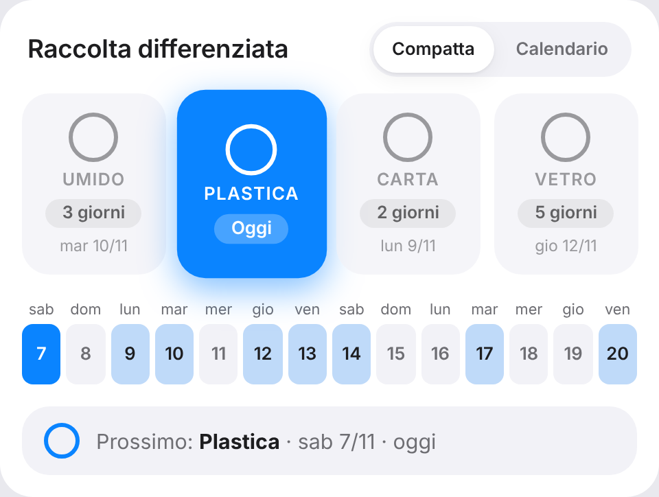
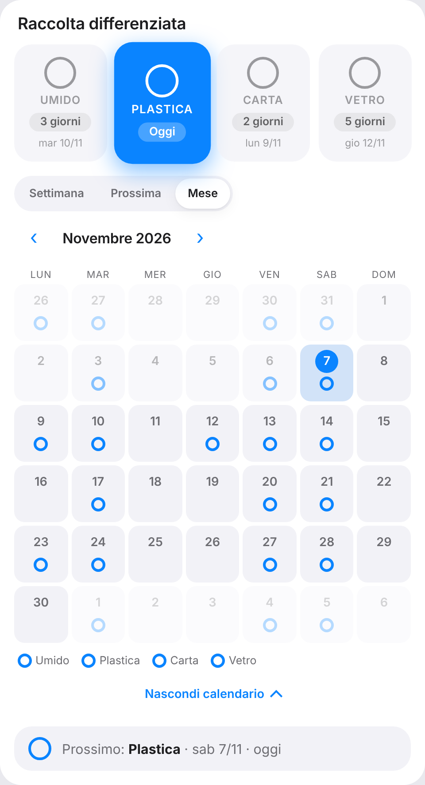
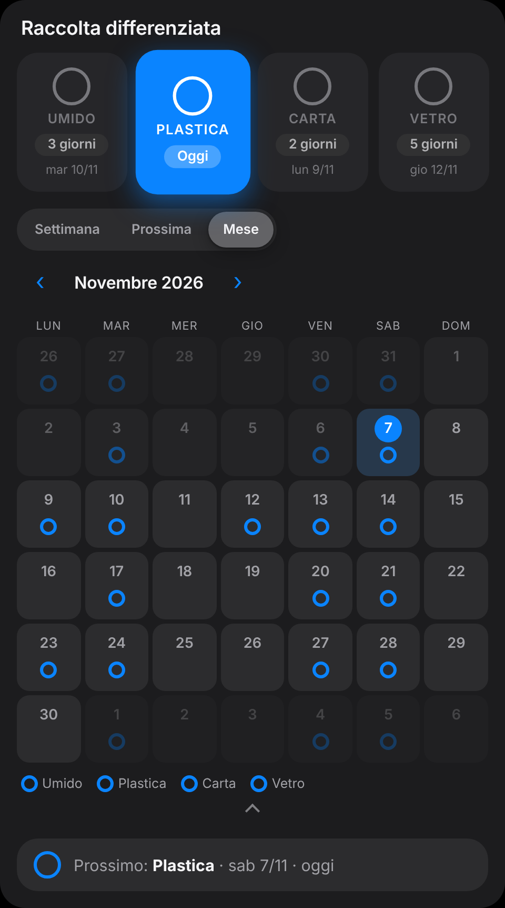
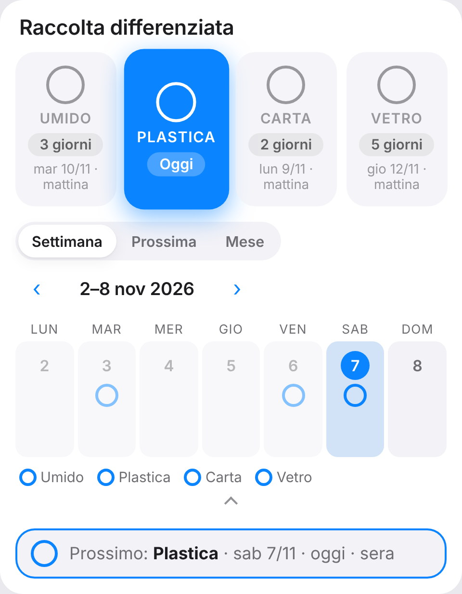
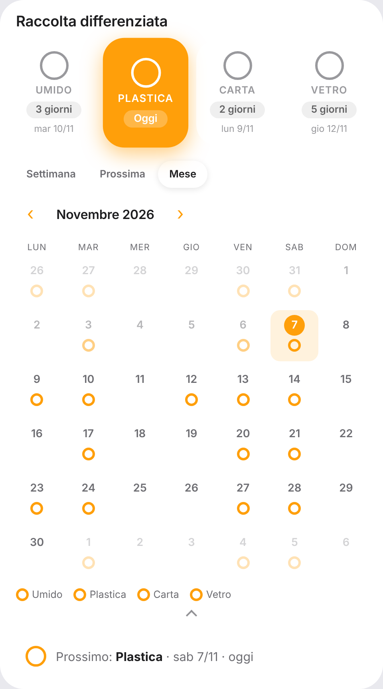
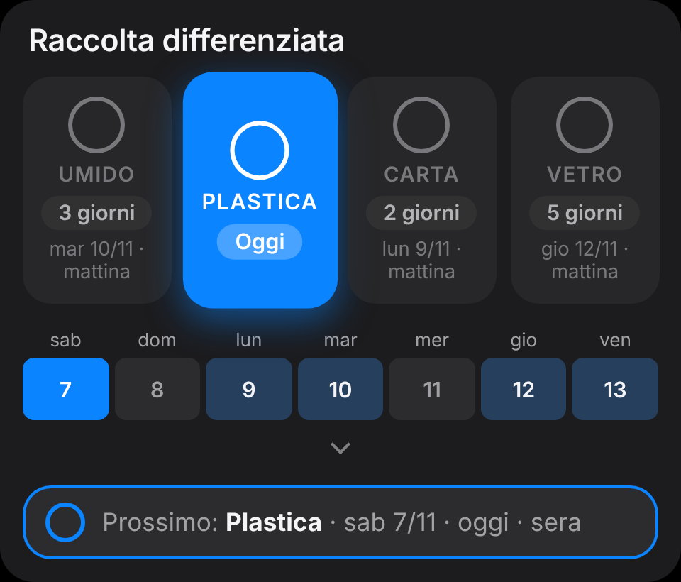
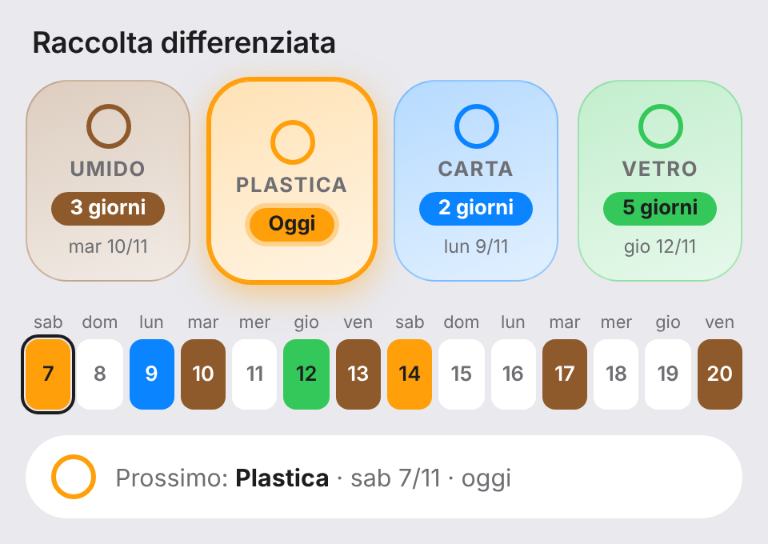
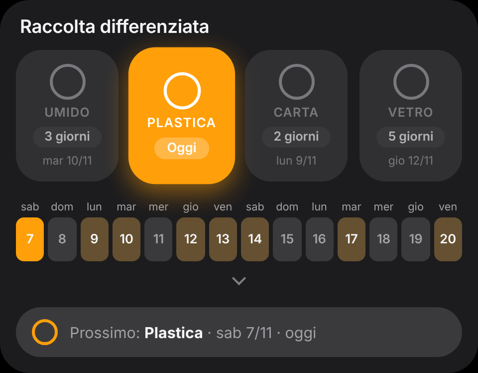
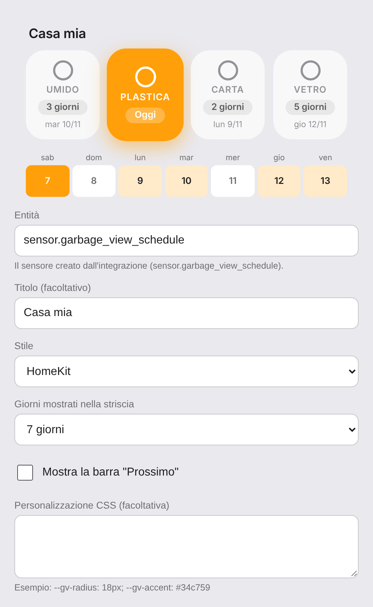

# HA Garbage View

[🇮🇹 Italiano](#italiano) · [🇬🇧 English](#english)



---

## Italiano

Integrazione per Home Assistant, installabile da HACS, che mostra **cosa buttare oggi e nei prossimi giorni** con una card Lovelace in stile Apple / HomeKit. Tutto gira in locale: nessuna rete, nessun account.

### Funzioni
- Tessere per ogni tipo di rifiuto, con badge «Oggi / Domani / N giorni» e data.
- Striscia di 7 o 14 giorni e barra riepilogo «Prossimo».
- **Calendario grande**: settimana, prossima settimana o mese, con frecce avanti/indietro e le icone dei rifiuti da portare fuori accanto a ogni giorno. Si apre **sul posto** dalla vista compatta: tocca il piccolo chevron sotto la striscia (la card compatta resta com'era: tessere e striscia dei giorni) e il calendario si espande con un'animazione, tocca di nuovo per richiuderlo.
- Ricorrenze: settimanale, ogni N settimane, n-esimo giorno del mese (anche «ultimo»), giorno del mese.
- Tipi gestiti dall'interfaccia (nome, icona, regola), senza YAML.
- Sensore `sensor.garbage_view_schedule` ed entità `calendar.garbage_view` per le automazioni.
- Due stili (`apple`, `homekit`), tema scuro automatico, animazioni leggere che rispettano `prefers-reduced-motion`.

### Installazione con HACS
1. HACS → ⋮ → **Repository personalizzati** → incolla `https://github.com/luca930/HA_GarbageView`, categoria **Integrazione**.
2. Cerca **HA Garbage View**, scarica, riavvia Home Assistant.
3. **Impostazioni → Dispositivi e servizi → Aggiungi integrazione → HA Garbage View**.

La card viene registrata automaticamente: non serve aggiungere risorse a mano.

### Configurazione
Dalla scheda dell'integrazione → **Configura** puoi aggiungere, modificare e rimuovere i tipi di rifiuto (nome, icona `mdi:`, ricorrenza).

Aggiungendo un tipo scegli prima un **preset** (Umido, Plastica, Carta, Vetro, Indifferenziato, Sfalci e verde, Lattine e metalli, Plastica e lattine, Ingombranti, Oli esausti, Tessili, Pile) che precompila nome (nella lingua di Home Assistant) e icona, oppure **Personalizzato…**. Nome e icona restano modificabili. L'icona si sceglie col selettore di Home Assistant (con ricerca e anteprima); se non trovi quella che ti serve, **scrivi a mano qualsiasi icona** `mdi:nome-icona` (le trovi su [pictogrammers.com/library/mdi](https://pictogrammers.com/library/mdi/)). Sono accettate solo icone nel formato `mdi:lettere-numeri-trattini`.

Poi aggiungi la card (anche dall'editor visuale):

```yaml
type: custom:garbage-view-card
entity: sensor.garbage_view_schedule   # obbligatorio
title: Raccolta differenziata          # opzionale
style: apple                           # apple | homekit
days: 7                                # 7 (default, settimana corrente) | 14
start_expanded: false                  # true = calendario già aperto (sostituisce `view: calendar`)
calendar_mode: week                    # week | next_week | month (periodo iniziale)
show_view_toggle: true                 # piccolo chevron per espandere il calendario
show_summary: true                     # barra «Prossimo»
css: "--gv-radius: 18px; --gv-accent: #34c759"   # opzionale
```

### Notifiche sul telefono
Da **Configura → Notifiche sul telefono** puoi attivare una notifica push all'app mobile di Home Assistant con l'elenco di ciò che c'è da portare fuori.

- **Dispositivi**: uno o più servizi `notify.mobile_app_*`.
- **Orario**: la mattina, per i rifiuti di oggi. Opzionale: promemoria la **sera prima** (per domani).
- **Non inviare se non c'è nulla** (attivo di default).
- **Lingua**: il testo segue la lingua di Home Assistant (italiano e inglese inclusi). Per aggiungerne una, copia `custom_components/garbage_view/notification_texts/en.json` come `<lingua>.json` e traduci.
- **Testi personalizzati** (opzionali, max 200 caratteri) con i segnaposto `{items}`, `{count}`, `{when}`, `{date}`.
- Fuso orario di Home Assistant, nessun polling, nessun doppio invio dopo un riavvio (se HA era spento all'orario, la notifica parte al riavvio entro 60 minuti).
- Servizio `garbage_view.send_test_notification` per provarla subito.

### Calendario grande
Toccando il chevron (o con `start_expanded: true`; la vecchia `view: calendar` funziona ancora) la card espande sul posto una griglia lunedì→domenica con le icone dei rifiuti in ogni giorno. **Settimana / Prossima / Mese** scelgono il periodo, le frecce ‹ › navigano (anche nei mesi passati). Oggi è evidenziato; toccando un giorno vedi i nomi, e una legenda spiega le icone. Le ricorrenze sono calcolate nella card dalle regole esposte dal sensore, quindi non serve alcuna configurazione in più.

| Mese · chiaro | Mese · scuro |
|---|---|
|  |  |
| **Settimana** | **Mese · HomeKit** |
|  |  |

### Personalizzare lo stile
Lo stile è fatto di variabili CSS pubbliche:

| Variabile | Cosa controlla |
|---|---|
| `--gv-font` | font |
| `--gv-bg` / `--gv-text` / `--gv-text-secondary` | sfondo e testi |
| `--gv-tile-bg` / `--gv-tile-size` | tessere |
| `--gv-radius` / `--gv-gap` / `--gv-shadow` | forme e spazi |
| `--gv-accent` | colore di evidenziazione |
| `--gv-anim-duration` | durata animazioni |

Due modi per cambiarle:

1. **Opzione `css` della card**: accetta solo proprietà `--gv-*` (il resto viene ignorato per sicurezza).
   ```yaml
   css: "--gv-radius: 12px; --gv-gap: 6px; --gv-accent: #ff9f0a"
   ```
2. **[card-mod](https://github.com/thomasloven/lovelace-card-mod)**, per chi lo usa già:
   ```yaml
   type: custom:garbage-view-card
   entity: sensor.garbage_view_schedule
   card_mod:
     style: |
       :host {
         --gv-bg: #1c1c1e;
         --gv-text: #fff;
         --gv-radius: 22px;
       }
   ```

### Sviluppo e test
```bash
pip install -r requirements_test.txt && pytest      # backend
npm ci && npm test && npm run test:e2e              # card (vitest + Playwright)
```
La CI esegue pytest, test della card, validazione HACS e hassfest. Per rilasciare: aggiorna `version` in `manifest.json`, poi `git tag vX.Y.Z && git push --tags` (il workflow crea la release con lo zip).

---

## English

A HACS-installable Home Assistant integration that shows **what to put out today and in the coming days**, with an Apple / HomeKit-style Lovelace card. Everything runs locally: no network, no account.

### Features
- One tile per waste type with a "Today / Tomorrow / N days" badge and date.
- 7- or 14-day strip and a "Next" summary bar.
- **Large calendar**: week, next week or month with previous/next arrows and small icons showing which waste goes out each day. It opens **in place** from the compact view: tap the small chevron under the strip (the compact card looks exactly as before: tiles and day strip) and it expands with a smooth animation; tap again to collapse.
- Recurrences: weekly, every N weeks, nth weekday of the month (including "last"), day of month.
- Waste types managed from the UI (name, icon, rule), no YAML needed.
- `sensor.garbage_view_schedule` and `calendar.garbage_view` entities for automations.
- Two styles (`apple`, `homekit`), automatic dark mode, light animations honoring `prefers-reduced-motion`.

### Install with HACS
1. HACS → ⋮ → **Custom repositories** → paste `https://github.com/luca930/HA_GarbageView`, category **Integration**.
2. Search for **HA Garbage View**, download, restart Home Assistant.
3. **Settings → Devices & services → Add integration → HA Garbage View**.

The card is registered automatically: no manual resource needed.

### Configuration
From the integration page → **Configure** you can add, edit and remove waste types (name, `mdi:` icon, recurrence).

When adding a type you first pick a **preset** (Organic, Plastic, Paper, Glass, General waste, Garden waste, Cans and metals, Plastic and cans, Bulky waste, Used oil, Textiles, Batteries) that prefills the name (in Home Assistant's language) and icon, or **Custom…**. Both stay editable. The icon uses Home Assistant's icon picker (search and preview); if the one you need is not listed, **type any** `mdi:icon-name` by hand (browse them at [pictogrammers.com/library/mdi](https://pictogrammers.com/library/mdi/)). Only icons in the `mdi:letters-digits-dashes` format are accepted.

Then add the card (the visual editor works too):

```yaml
type: custom:garbage-view-card
entity: sensor.garbage_view_schedule   # required
title: Recycling                       # optional
style: apple                           # apple | homekit
days: 7                                # 7 (default, current week) | 14
start_expanded: false                  # true = calendar already open (replaces `view: calendar`)
calendar_mode: week                    # week | next_week | month (initial period)
show_view_toggle: true                 # small chevron to expand the calendar
show_summary: true                     # "Next" bar
css: "--gv-radius: 18px; --gv-accent: #34c759"   # optional
```

### Mobile notifications
From **Configure → Mobile notifications** you can enable a push notification to the Home Assistant mobile app listing what to put out.

- **Devices**: one or more `notify.mobile_app_*` services.
- **Time**: in the morning, for today's waste. Optional reminder the **evening before** (for tomorrow).
- **Skip when nothing is due** (on by default).
- **Language**: the text follows the Home Assistant language (Italian and English included). To add one, copy `custom_components/garbage_view/notification_texts/en.json` to `<language>.json` and translate it.
- **Custom texts** (optional, max 200 characters) with the placeholders `{items}`, `{count}`, `{when}`, `{date}`.
- Home Assistant time zone, no polling, no duplicates after a restart (if HA was down at the scheduled time, it is sent on startup within 60 minutes).
- Service `garbage_view.send_test_notification` to try it right away.

### Large calendar
By tapping the chevron (or with `start_expanded: true`; the old `view: calendar` still works) the card expands in place to show a Monday→Sunday grid with the waste icons on each day. **Week / Next / Month** pick the period and the ‹ › arrows navigate (past months included). Today is highlighted; tap a day to see names, and a legend explains the icons. Recurrences are computed in the card from the rules exposed by the sensor, so no extra setup is needed.

See the screenshots below (`docs/screenshots/calendario-*.png`).

### Customizing the style
Styling is driven by public CSS variables (`--gv-font`, `--gv-bg`, `--gv-text`, `--gv-text-secondary`, `--gv-tile-bg`, `--gv-tile-size`, `--gv-radius`, `--gv-gap`, `--gv-accent`, `--gv-shadow`, `--gv-anim-duration`).

1. **The card's `css` option**: only `--gv-*` properties are accepted, anything else is ignored for safety.
2. **[card-mod](https://github.com/thomasloven/lovelace-card-mod)**: set the same variables under `card_mod.style` on `:host` (see the example above).

### Development and tests
```bash
pip install -r requirements_test.txt && pytest      # backend
npm ci && npm test && npm run test:e2e              # card (vitest + Playwright)
```
CI runs pytest, card tests, HACS validation and hassfest. To release: bump `version` in `manifest.json`, then `git tag vX.Y.Z && git push --tags` (the workflow publishes the release with the zip).

### Screenshots

| Apple · light | Apple · dark |
|---|---|
|  |  |
| **HomeKit · light** | **HomeKit · dark** |
|  |  |



| Calendar · month · light | Calendar · month · dark |
|---|---|
|  |  |
| **Calendar · week** | **Calendar · month · HomeKit** |
|  |  |
